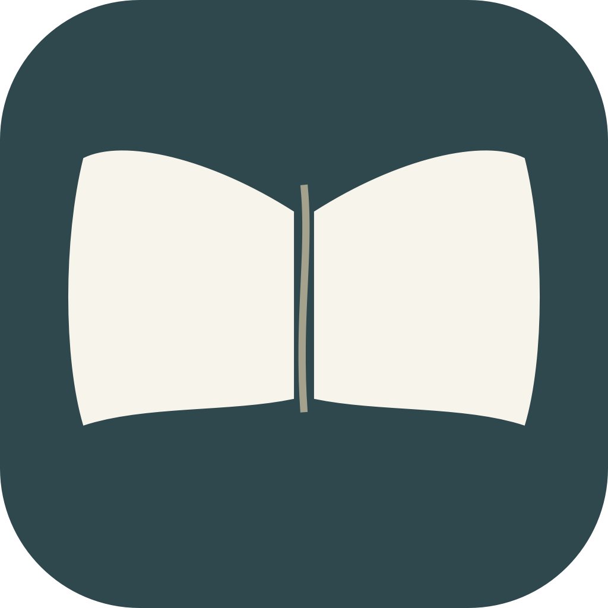
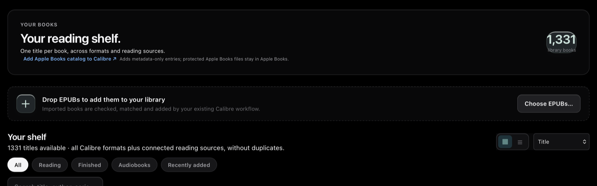

# Shelf

**A calm, unified reading dashboard for macOS.** Shelf brings your Calibre library, reading progress, connected services, and supported devices into one place while keeping your book files under your control.

<p align="center">
  
</p>

> Current version: **0.1.33** · macOS · MIT licensed

## What Shelf does

- **One shelf across sources.** Browse Calibre titles and formats alongside reading records from Apple Books, Hardcover, and connected readers. Matching uses title and author evidence so different editions can share one shelf entry.
- **Covers and metadata.** Loads embedded Calibre covers, then tries the public Open Library cover catalog for missing artwork. If no reliable cover is available, Shelf shows a readable title card instead of an empty image box.
- **Read and track.** Open EPUBs in the built-in paginated reader, keep progress and highlights, and view finish status and reading statistics.
- **Sync services.** Check Calibre, KOReader Sync, CrossPoint, Hardcover, Readwise, and Readwise Reader connections from the dashboard.
- **Device setup.** Configure supported KOReader/CrossPoint readers and see when a reader last sent progress. A disconnected reader can only upload after it reconnects to Wi-Fi.
- **A focused interface.** Choose Black (OLED black) or Bright. Motion follows macOS reduced-motion settings and uses native WebKit timing at the display’s supported refresh rate.

### Shelf in action

The public screenshot shows the library and import controls without exposing a personal book list or local network address.



## Install and build

Requirements: macOS, Xcode, Python 3, and a local Calibre library.

```sh
git clone https://github.com/Somamill/Shelf.git
cd Shelf
Scripts/build-and-install.sh
```

Alternatively, open `Shelf.xcodeproj` in Xcode and build the `Shelf` scheme. Complete **Setup** on first launch and choose the Calibre library and incoming-book folder. Shelf does not require Homebrew or third-party Swift packages for its core features.

## Set up your reading sources

1. Choose a local Calibre library and a folder for incoming books.
2. Add the services and devices you use under **Connections** and **Setup**.
3. Keep Calibre’s active library on local storage. Use iCloud Drive, OneDrive, or Google Drive only for incoming files that their official sync app downloads to this Mac. Do not sync Calibre’s live database folder through a cloud drive.
4. On CrossPoint/KOReader devices, enable document metadata and sync when the reader is back online. Shelf processes a reader upload automatically; it cannot make a disconnected device upload over Wi-Fi.

Apple Books support reads the locally synced Books database on this Mac and reports available progress. Protected Apple Books files stay in Books; Shelf does not copy or alter them. Catalog metadata import is separate from importing book files.

## Privacy and data safety

- Shelf reads Calibre metadata and cover files locally. User passwords and API keys are kept in owner-only files under `~/Library/Application Support/Shelf`.
- Apple Books data is read locally. The catalog importer creates metadata-only Calibre entries and does not copy protected book content.
- Shelf does not upload your library to a Shelf-operated cloud service. Connected services receive only the data needed for the enabled sync feature.
- Review diagnostic exports before sharing. Never commit credentials, private library databases, or personal logs.

## Project layout

```text
Sources/ShelfCore/       Shared models and core logic
Sources/ShelfMacApp/     Native macOS application and service adapters
Resources/Dashboard/     Shelf dashboard and reader interface
Resources/Icons/         App icon and macOS icon set
Scripts/                 Build and optional maintenance helpers
Documentation/           Architecture, dependencies, and screenshots
```

See [Architecture](Documentation/ARCHITECTURE.md), [Dependencies](Documentation/DEPENDENCIES.md), [Security](SECURITY.md), [Contributing](CONTRIBUTING.md), and [Changelog](CHANGELOG.md).

## Scope

Shelf is currently a macOS app. The shared core is structured to support a future iPhone companion, but an iPhone app and direct Google Drive/Microsoft Graph integrations are not included in this release. Cloud-drive support means using files that the provider’s official macOS sync client has made available locally.

## License

Shelf is released under the [MIT License](LICENSE).
